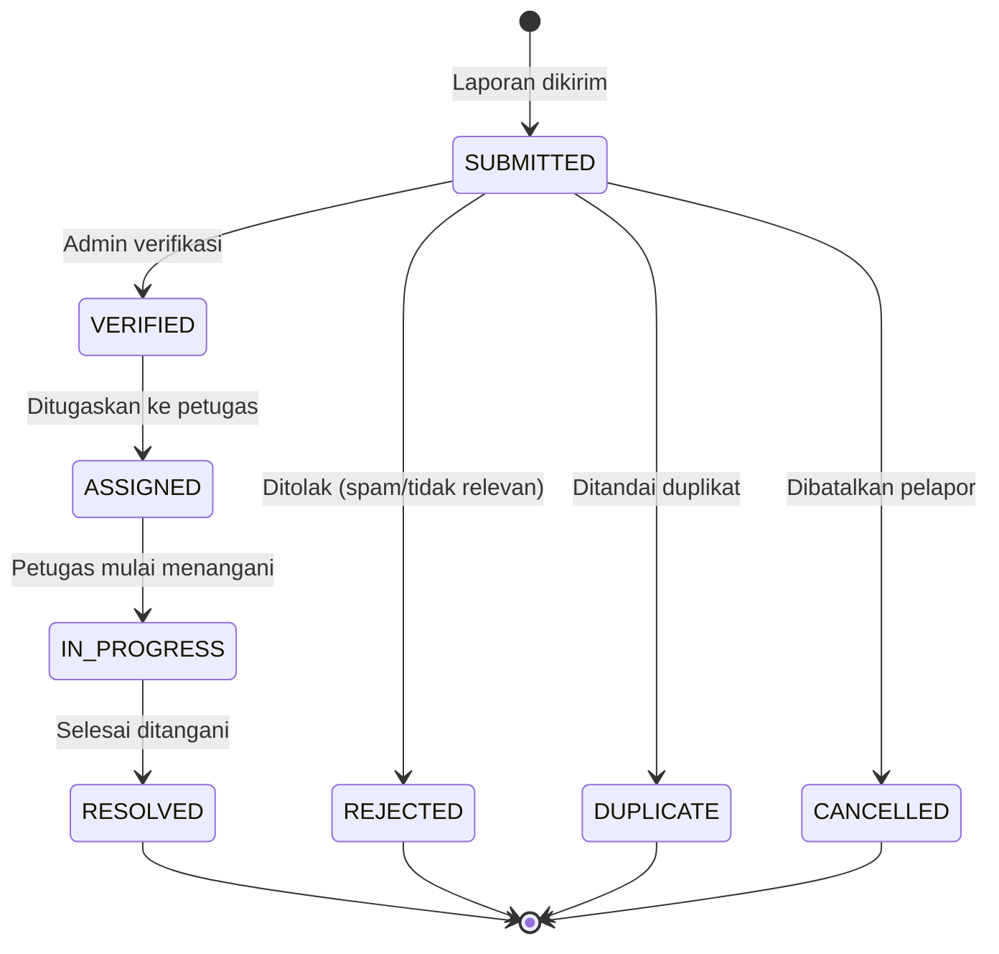
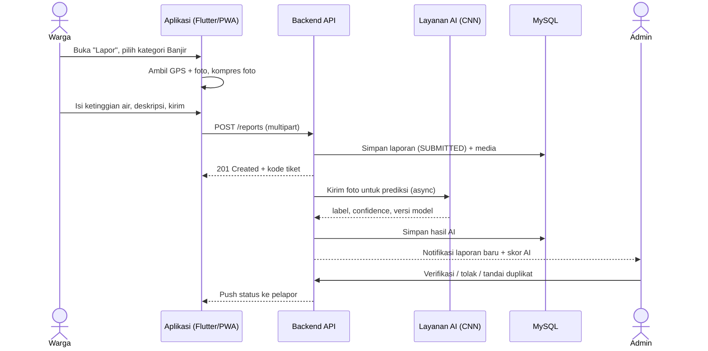
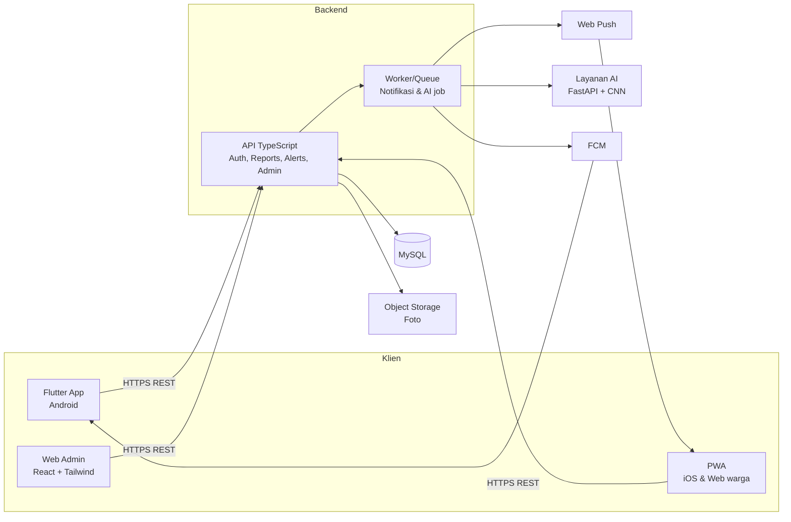
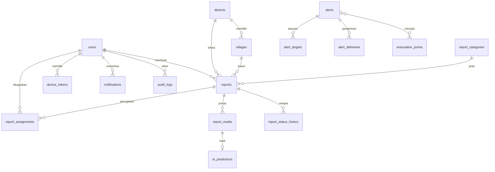

# PRD — DERMAYU

**Dering Evakuasi, Respons Masyarakat, dan Aduan Wilayah Indramayu**

| Item | Keterangan |
|---|---|
| Versi dokumen | 0.1 (Draft awal) |
| Status | Draft, menunggu review tim |
| Product Owner / Lead Dev | Romi Setiawan |
| Tim | Lead Dev (Mobile + Web + Backend), AI Engineer (CNN), Administrasi & Dokumentasi |
| Platform | Android (Flutter), iOS via PWA, Web Admin |
| Terakhir diperbarui | 10 Oktober 2026 |

> Catatan penggunaan: setiap requirement punya ID unik (misal `FR-RPT-03`, `NFR-PERF-01`) supaya mudah dirujuk di issue tracker, proposal, dan pengujian. Item bertanda **[MVP]** wajib ada di rilis pertama, **[v1.1]** tahap lanjutan, **[Future]** ide jangka panjang.

---

## Daftar Isi

1. [Ringkasan Produk](#1-ringkasan-produk)
2. [Latar Belakang dan Masalah](#2-latar-belakang-dan-masalah)
3. [Visi, Tujuan, dan Metrik Keberhasilan](#3-visi-tujuan-dan-metrik-keberhasilan)
4. [Ruang Lingkup](#4-ruang-lingkup)
5. [Persona dan Peran Pengguna](#5-persona-dan-peran-pengguna)
6. [User Stories](#6-user-stories)
7. [Kebutuhan Fungsional](#7-kebutuhan-fungsional)
8. [Alur Pengguna Utama](#8-alur-pengguna-utama)
9. [Integrasi AI (CNN Validasi Foto Banjir)](#9-integrasi-ai-cnn-validasi-foto-banjir)
10. [Kebutuhan Non-Fungsional](#10-kebutuhan-non-fungsional)
11. [Arsitektur Sistem dan Tech Stack](#11-arsitektur-sistem-dan-tech-stack)
12. [Model Data (MySQL)](#12-model-data-mysql)
13. [Spesifikasi API](#13-spesifikasi-api)
14. [Desain UI/UX](#14-desain-uiux)
15. [Strategi PWA untuk iOS](#15-strategi-pwa-untuk-ios)
16. [Notifikasi dan Dering Evakuasi](#16-notifikasi-dan-dering-evakuasi)
17. [Keamanan dan Privasi](#17-keamanan-dan-privasi)
18. [Analitik dan Pelaporan](#18-analitik-dan-pelaporan)
19. [Strategi Pengujian](#19-strategi-pengujian)
20. [Deployment dan DevOps](#20-deployment-dan-devops)
21. [Roadmap dan Milestone](#21-roadmap-dan-milestone)
22. [Pembagian Tugas Tim](#22-pembagian-tugas-tim)
23. [Risiko dan Mitigasi](#23-risiko-dan-mitigasi)
24. [Asumsi dan Pertanyaan Terbuka](#24-asumsi-dan-pertanyaan-terbuka)
25. [Glosarium](#25-glosarium)

---

## 1. Ringkasan Produk

**DERMAYU** adalah platform pelaporan berbasis lokasi untuk masyarakat Kabupaten Indramayu. Warga dapat melaporkan kejadian di wilayahnya (fokus utama: **banjir**, serta aduan wilayah lain seperti tanggul jebol, drainase tersumbat, dan jalan rusak) lengkap dengan foto dan titik lokasi. Petugas dan admin memantau, memverifikasi, dan menindaklanjuti laporan melalui dashboard web. Ketika situasi berbahaya, admin dapat mengirim **Dering Evakuasi**: peringatan push berprioritas tinggi ke warga di area terdampak, lengkap dengan informasi titik evakuasi.

Foto laporan banjir divalidasi oleh **model CNN** untuk membantu petugas memprioritaskan laporan yang kemungkinan besar benar dan menyaring laporan palsu atau tidak relevan.

**Filosofi nama:** "DERMAYU" adalah sebutan lokal untuk Indramayu. Nama ini dipilih agar platform terasa dekat, akrab, dan bersahabat bagi masyarakat setempat, bukan sekadar aplikasi pemerintah yang kaku. Singkatan "Dering Evakuasi, Respons Masyarakat, dan Aduan Wilayah Indramayu" menggambarkan tiga fungsi inti: peringatan, respons, dan aduan.

### 1.1 Komponen Produk

| Komponen | Teknologi | Pengguna Utama |
|---|---|---|
| Aplikasi mobile native | Flutter + Dart (Android) | Warga |
| PWA | React + TypeScript (instalable) | Warga pengguna iOS, dan siapa pun tanpa install |
| Web Admin | React + TypeScript + Tailwind | Admin, petugas, relawan koordinator |
| Backend API | TypeScript (Node.js) + MySQL | Semua klien |
| Layanan AI | Model CNN (dikerjakan anggota tim AI) | Backend (internal) |

---

## 2. Latar Belakang dan Masalah

Indramayu berada di dataran rendah pesisir utara Jawa Barat, dilalui sungai besar dan jaringan irigasi, sehingga rawan banjir terutama pada musim hujan. Beberapa masalah yang ingin diselesaikan:

1. **Pelaporan tersebar dan lambat.** Laporan warga masuk lewat grup WhatsApp, telepon, atau media sosial tanpa format baku, sehingga sulit dilacak dan mudah terlewat.
2. **Lokasi tidak akurat.** Laporan berbentuk teks "banjir di dekat pasar" tanpa koordinat menyulitkan petugas menentukan titik tepat.
3. **Sulit memverifikasi.** Foto lama, foto dari daerah lain, atau hoaks bisa tercampur dengan laporan asli.
4. **Peringatan tidak terarah.** Informasi evakuasi disebar umum, tidak menyasar warga yang benar-benar berada di area terdampak.
5. **Tidak ada transparansi tindak lanjut.** Pelapor tidak tahu apakah laporannya sudah diterima dan ditangani.
6. **Data historis minim.** Pemerintah daerah kesulitan memetakan titik rawan karena data kejadian tidak terdokumentasi rapi.

> Catatan untuk proposal: angka statistik kejadian banjir, jumlah penduduk terdampak, dan kebijakan daerah sebaiknya dikutip dari sumber resmi (BPBD Indramayu, BPS, BNPB) oleh tim administrasi. Bagian ini sengaja tidak diisi angka agar tidak ada klaim tanpa sumber.

---

## 3. Visi, Tujuan, dan Metrik Keberhasilan

### 3.1 Visi
Menjadi kanal terpercaya yang menghubungkan warga Indramayu dengan petugas penanganan bencana dan layanan wilayah secara cepat, akurat, dan transparan.

### 3.2 Tujuan Produk

| ID | Tujuan |
|---|---|
| G-01 | Mempermudah warga melapor kejadian dalam waktu kurang dari 1 menit |
| G-02 | Memberi petugas data laporan yang terstruktur, berkoordinat, dan terverifikasi |
| G-03 | Mengurangi laporan palsu/tidak relevan dengan bantuan validasi AI |
| G-04 | Menyampaikan peringatan dan arahan evakuasi tepat sasaran ke area terdampak |
| G-05 | Memberi transparansi status tindak lanjut kepada pelapor |
| G-06 | Menghasilkan data historis untuk pemetaan titik rawan |

### 3.3 Metrik Keberhasilan (target awal, disesuaikan setelah uji lapangan)

| Metrik | Definisi | Target Awal |
|---|---|---|
| Waktu buat laporan | Dari buka form sampai kirim | ≤ 60 detik (median) |
| Waktu verifikasi | Laporan masuk sampai status "Terverifikasi" | ≤ 30 menit pada jam kerja |
| Waktu respons | Laporan masuk sampai "Ditugaskan" | ≤ 60 menit |
| Kualitas AI | Recall kelas banjir pada data uji lokal | ≥ 0,90 (diukur nyata, lihat bagian 9) |
| Keterjangkauan Dering | Persentase perangkat target yang menerima push dalam 60 detik | ≥ 90% |
| Adopsi | Jumlah warga terdaftar saat uji coba | Ditetapkan bersama pembimbing/mitra |
| Kepuasan | Skor kepuasan pengguna pada uji coba | ≥ 4/5 |

---

## 4. Ruang Lingkup

### 4.1 Dalam Lingkup (In Scope)

- Registrasi dan login warga, petugas, admin
- Pembuatan laporan (kategori, foto, lokasi, deskripsi, tingkat keparahan)
- Validasi foto banjir otomatis oleh model CNN
- Peta sebaran laporan (peta interaktif)
- Alur verifikasi, penugasan, dan penyelesaian laporan
- Dering Evakuasi (broadcast peringatan berbasis wilayah)
- Informasi titik evakuasi dan kontak darurat
- Notifikasi push (FCM untuk Android, Web Push untuk PWA iOS)
- Dashboard admin dan statistik
- Riwayat dan pelacakan status laporan oleh pelapor

### 4.2 Di Luar Lingkup (Out of Scope) untuk Rilis Awal

- Integrasi langsung ke sistem internal BPBD/pemerintah (disiapkan lewat API, belum diintegrasikan)
- Prediksi banjir (forecasting) dari data cuaca/tinggi muka air [Future]
- Aplikasi iOS native (diganti PWA)
- Pembayaran/donasi
- Chat real-time antar-warga
- SMS gateway berbayar [Future]

### 4.3 Prioritas Rilis

| Fase | Isi |
|---|---|
| **MVP** | Auth, buat laporan + foto + lokasi, status laporan, validasi AI, dashboard admin dasar, peta laporan, notifikasi status |
| **v1.1** | Dering Evakuasi lengkap, titik evakuasi, PWA iOS penuh, statistik lanjutan, ekspor laporan |
| **Future** | Mode offline-first penuh, integrasi data cuaca/TMA, multibahasa (Indonesia + Jawa/Dermayu), integrasi WhatsApp, prediksi titik rawan |

---

## 5. Persona dan Peran Pengguna

### 5.1 Persona

**Persona 1: Warga Pelapor (Bu Sari, 42, pedagang pasar)**
- Menggunakan Android kelas menengah, koneksi kadang lemah
- Butuh cara cepat melapor tanpa banyak ketik
- Ingin tahu apakah laporannya ditindaklanjuti

**Persona 2: Warga Pengguna iOS (Raka, 20, mahasiswa)**
- Memakai iPhone, malas memasang aplikasi baru
- Cukup membuka tautan, lalu "Tambahkan ke Layar Utama"

**Persona 3: Petugas Lapangan / Relawan (Pak Dedi, 35)**
- Menerima penugasan, perlu rute ke lokasi dan cara memperbarui status dari HP
- Sering bekerja di area dengan sinyal buruk

**Persona 4: Admin / Operator Pusat Komando (Bu Rina, 30)**
- Memantau dashboard di desktop, memverifikasi laporan, mengirim Dering Evakuasi
- Butuh ringkasan cepat, filter, dan peta

### 5.2 Peran dan Hak Akses (RBAC)

| Peran | Kode | Hak Akses Utama |
|---|---|---|
| Warga | `CITIZEN` | Buat/lihat laporan sendiri, lihat peta publik, terima Dering, lihat titik evakuasi |
| Petugas/Relawan | `OFFICER` | Semua hak warga + lihat penugasan, ubah status laporan yang ditugaskan, unggah bukti penanganan |
| Admin | `ADMIN` | Verifikasi/tolak laporan, penugasan, kirim Dering, kelola titik evakuasi, lihat statistik |
| Super Admin | `SUPERADMIN` | Semua hak admin + kelola akun admin/petugas, kelola kategori & wilayah, lihat audit log |

---

## 6. User Stories

### Warga
- **US-01** Sebagai warga, saya ingin melapor banjir dengan foto dan lokasi otomatis agar petugas tahu tempat tepatnya.
- **US-02** Sebagai warga, saya ingin melihat status laporan saya agar tahu sudah ditangani atau belum.
- **US-03** Sebagai warga, saya ingin melihat peta laporan di sekitar saya agar tahu area yang berbahaya.
- **US-04** Sebagai warga, saya ingin menerima peringatan evakuasi jika area saya terdampak agar bisa menyelamatkan diri.
- **US-05** Sebagai warga, saya ingin melihat titik evakuasi terdekat dan rutenya.
- **US-06** Sebagai warga, saya ingin tetap bisa menyusun laporan saat sinyal lemah dan terkirim otomatis ketika koneksi kembali.
- **US-07** Sebagai warga iOS, saya ingin memakai DERMAYU lewat PWA tanpa harus memasang aplikasi dari App Store.

### Petugas
- **US-08** Sebagai petugas, saya ingin menerima notifikasi penugasan beserta lokasi dan foto.
- **US-09** Sebagai petugas, saya ingin memperbarui status dan mengunggah foto bukti penanganan dari HP.

### Admin
- **US-10** Sebagai admin, saya ingin melihat daftar laporan dengan skor AI agar bisa memprioritaskan verifikasi.
- **US-11** Sebagai admin, saya ingin memverifikasi, menolak (dengan alasan), atau menandai duplikat suatu laporan.
- **US-12** Sebagai admin, saya ingin mengirim Dering Evakuasi ke kecamatan/desa/radius tertentu.
- **US-13** Sebagai admin, saya ingin melihat statistik dan titik rawan agar bisa menyusun laporan dan perencanaan.
- **US-14** Sebagai super admin, saya ingin mengelola akun petugas dan melihat jejak audit.

---

## 7. Kebutuhan Fungsional

### 7.1 Autentikasi dan Akun (AUTH)

| ID | Kebutuhan | Prioritas |
|---|---|---|
| FR-AUTH-01 | Registrasi warga dengan nama, nomor HP atau email, dan password | MVP |
| FR-AUTH-02 | Login dengan identitas + password; menghasilkan access token dan refresh token | MVP |
| FR-AUTH-03 | Logout dan pencabutan refresh token | MVP |
| FR-AUTH-04 | Lupa/reset password melalui email atau OTP | MVP |
| FR-AUTH-05 | Akun petugas dan admin dibuat oleh Super Admin (tidak ada registrasi publik) | MVP |
| FR-AUTH-06 | Pembatasan percobaan login (rate limit + penguncian sementara) | MVP |
| FR-AUTH-07 | Mode tamu terbatas untuk "Lapor Cepat" (lihat bagian 24) | v1.1 |
| FR-AUTH-08 | Verifikasi nomor HP via OTP | v1.1 |
| FR-AUTH-09 | Login dengan Google | Future |

### 7.2 Profil Pengguna (PROF)

| ID | Kebutuhan | Prioritas |
|---|---|---|
| FR-PROF-01 | Ubah nama, foto profil, nomor HP | MVP |
| FR-PROF-02 | Atur wilayah tinggal (kecamatan/desa) untuk target Dering | MVP |
| FR-PROF-03 | Atur preferensi notifikasi (status laporan, Dering, info umum) | v1.1 |
| FR-PROF-04 | Hapus akun dan data pribadi atas permintaan pengguna | v1.1 |

### 7.3 Pelaporan (RPT)

| ID | Kebutuhan | Prioritas |
|---|---|---|
| FR-RPT-01 | Form laporan: kategori, deskripsi singkat, foto (1–5), lokasi, tingkat keparahan | MVP |
| FR-RPT-02 | Lokasi otomatis dari GPS dengan opsi geser pin pada peta; alamat tampil hasil reverse geocoding | MVP |
| FR-RPT-03 | Foto dari kamera atau galeri; kompresi di sisi klien sebelum unggah (target ≤ 1 MB per foto) | MVP |
| FR-RPT-04 | Untuk kategori Banjir: pilihan estimasi ketinggian air (mata kaki, lutut, paha, pinggang, di atas dada) | MVP |
| FR-RPT-05 | Metadata otomatis: waktu kejadian, koordinat, akurasi GPS, perangkat | MVP |
| FR-RPT-06 | Sistem menetapkan kode tiket unik per laporan (contoh: `DMY-20261020-0001`) | MVP |
| FR-RPT-07 | Pelapor dapat melihat daftar dan detail laporannya beserta riwayat status | MVP |
| FR-RPT-08 | Pelapor dapat membatalkan laporan selama status masih "Diterima" | MVP |
| FR-RPT-09 | Deteksi laporan duplikat berdasarkan kedekatan lokasi (radius) + waktu + kategori; ditandai untuk admin | v1.1 |
| FR-RPT-10 | Antrean offline: laporan disimpan lokal dan dikirim otomatis saat online | v1.1 |
| FR-RPT-11 | Pelapor dapat menambah foto/keterangan tambahan pada laporan aktif | v1.1 |
| FR-RPT-12 | Opsi melapor sebagai anonim terhadap publik (identitas tetap tercatat untuk admin) | v1.1 |

**Kategori laporan awal:**

| Kode | Kategori | Validasi AI |
|---|---|---|
| `FLOOD` | Banjir / genangan | Ya |
| `LEVEE` | Tanggul/irigasi jebol atau retak | Tidak (MVP) |
| `DRAINAGE` | Drainase/gorong-gorong tersumbat | Tidak |
| `ROAD` | Jalan rusak/tergenang parah | Tidak |
| `TREE` | Pohon tumbang | Tidak |
| `OTHER` | Lainnya | Tidak |

**Tingkat keparahan:** `LOW`, `MEDIUM`, `HIGH`, `CRITICAL` (diisi pelapor sebagai usulan; admin dapat mengubah).

**Siklus status laporan:**



Setiap perubahan status dicatat di tabel riwayat (siapa, kapan, catatan) dan memicu notifikasi ke pelapor.

### 7.4 Peta dan Informasi Publik (MAP)

| ID | Kebutuhan | Prioritas |
|---|---|---|
| FR-MAP-01 | Peta interaktif menampilkan laporan terverifikasi sebagai marker berwarna sesuai tingkat keparahan | MVP |
| FR-MAP-02 | Filter peta berdasarkan kategori, rentang waktu, dan status | MVP |
| FR-MAP-03 | Detail singkat laporan saat marker diketuk (foto, waktu, status); data pribadi pelapor tidak ditampilkan | MVP |
| FR-MAP-04 | Clustering marker pada zoom jauh | MVP |
| FR-MAP-05 | Layer titik evakuasi dan posko | v1.1 |
| FR-MAP-06 | Layer area terdampak (poligon) dari Dering aktif | v1.1 |
| FR-MAP-07 | Heatmap titik rawan berdasarkan data historis | v1.1 |
| FR-MAP-08 | Navigasi ke titik evakuasi (membuka aplikasi peta eksternal) | v1.1 |

### 7.5 Penanganan oleh Petugas (OPS)

| ID | Kebutuhan | Prioritas |
|---|---|---|
| FR-OPS-01 | Daftar tugas petugas dengan filter status | MVP |
| FR-OPS-02 | Petugas dapat mengubah status ASSIGNED → IN_PROGRESS → RESOLVED | MVP |
| FR-OPS-03 | Petugas menambah catatan penanganan dan foto bukti | MVP |
| FR-OPS-04 | Notifikasi penugasan baru | MVP |
| FR-OPS-05 | Tombol "Buka rute" ke lokasi laporan | v1.1 |
| FR-OPS-06 | Pelacakan lokasi petugas (opt-in) untuk koordinasi | Future |

### 7.6 Web Admin (ADM)

| ID | Kebutuhan | Prioritas |
|---|---|---|
| FR-ADM-01 | Dashboard ringkasan: jumlah laporan per status, per kategori, laporan kritis terbaru | MVP |
| FR-ADM-02 | Tabel laporan dengan pencarian, filter (status, kategori, kecamatan, tanggal, skor AI), sortir, paginasi | MVP |
| FR-ADM-03 | Halaman detail laporan: foto, peta, skor AI, riwayat status, aksi verifikasi/tolak/duplikat/tugaskan | MVP |
| FR-ADM-04 | Penolakan wajib menyertakan alasan (ditampilkan ke pelapor) | MVP |
| FR-ADM-05 | Penugasan laporan ke petugas | MVP |
| FR-ADM-06 | Peta pusat komando dengan semua laporan aktif | MVP |
| FR-ADM-07 | Manajemen pengguna (petugas, admin) oleh Super Admin | MVP |
| FR-ADM-08 | Manajemen titik evakuasi (CRUD + lokasi + kapasitas + kontak) | v1.1 |
| FR-ADM-09 | Modul Dering Evakuasi (buat, pratinjau, kirim, hentikan, riwayat) | v1.1 |
| FR-ADM-10 | Manajemen master data: kategori, kecamatan, desa | v1.1 |
| FR-ADM-11 | Ekspor laporan ke CSV/XLSX/PDF | v1.1 |
| FR-ADM-12 | Audit log aktivitas admin | v1.1 |
| FR-ADM-13 | Pembaruan real-time (laporan baru muncul tanpa refresh) | v1.1 |

### 7.7 Dering Evakuasi (ALERT)

| ID | Kebutuhan | Prioritas |
|---|---|---|
| FR-ALERT-01 | Admin membuat Dering dengan judul, pesan, level, wilayah target, dan titik evakuasi terkait | v1.1 |
| FR-ALERT-02 | Level peringatan: `WASPADA`, `SIAGA`, `AWAS`, `EVAKUASI` | v1.1 |
| FR-ALERT-03 | Target wilayah: seluruh kabupaten, per kecamatan, per desa, atau radius dari satu titik | v1.1 |
| FR-ALERT-04 | Pratinjau jumlah penerima perkiraan sebelum kirim, dengan konfirmasi dua langkah | v1.1 |
| FR-ALERT-05 | Pengiriman push prioritas tinggi; pada level EVAKUASI, notifikasi tampil layar penuh/suara khas bila platform mengizinkan | v1.1 |
| FR-ALERT-06 | Dering dapat diperbarui atau dinyatakan "Berakhir" | v1.1 |
| FR-ALERT-07 | Riwayat Dering dan statistik pengiriman (terkirim, gagal, dibuka) | v1.1 |
| FR-ALERT-08 | Halaman "Dering Aktif" di aplikasi, tetap bisa dilihat meski push terlewat | v1.1 |
| FR-ALERT-09 | Perlindungan penyalahgunaan: hanya `ADMIN`/`SUPERADMIN`, tercatat di audit log | v1.1 |

### 7.8 Titik Evakuasi dan Kontak Darurat (EVAC)

| ID | Kebutuhan | Prioritas |
|---|---|---|
| FR-EVAC-01 | Daftar titik evakuasi: nama, alamat, koordinat, kapasitas, fasilitas, kontak PIC | v1.1 |
| FR-EVAC-02 | Urutkan berdasarkan jarak dari lokasi pengguna | v1.1 |
| FR-EVAC-03 | Daftar kontak darurat (BPBD, PMI, Damkar, Puskesmas, kepolisian) dengan tombol telepon | MVP |

### 7.9 Notifikasi (NOTIF)

| ID | Kebutuhan | Prioritas |
|---|---|---|
| FR-NOTIF-01 | Notifikasi perubahan status laporan ke pelapor | MVP |
| FR-NOTIF-02 | Notifikasi penugasan ke petugas | MVP |
| FR-NOTIF-03 | Notifikasi laporan baru/berisiko tinggi ke admin (web) | MVP |
| FR-NOTIF-04 | Pusat notifikasi dalam aplikasi (riwayat, tandai dibaca) | MVP |
| FR-NOTIF-05 | Notifikasi Dering Evakuasi | v1.1 |

---

## 8. Alur Pengguna Utama

### 8.1 Alur Membuat Laporan Banjir



Catatan: pengiriman laporan **tidak menunggu** hasil AI. Laporan langsung diterima, AI diproses asinkron, sehingga warga tidak terhambat bila layanan AI lambat atau mati.

### 8.2 Alur Dering Evakuasi

1. Admin membuka modul Dering → "Buat Dering".
2. Mengisi level, judul, pesan, wilayah target, titik evakuasi.
3. Sistem menghitung estimasi penerima, admin mengonfirmasi dua langkah.
4. Backend memilih perangkat target (berdasarkan wilayah profil dan/atau lokasi terakhir) lalu mengirim lewat FCM (Android) dan Web Push (PWA).
5. Warga menerima notifikasi, membuka halaman Dering Aktif, melihat titik evakuasi terdekat.
6. Admin dapat memperbarui atau menutup Dering; warga menerima pembaruan.

### 8.3 Alur Penugasan dan Penyelesaian

1. Admin memverifikasi laporan → status `VERIFIED`.
2. Admin menugaskan ke petugas → `ASSIGNED`, petugas dapat push.
3. Petugas tiba di lokasi → `IN_PROGRESS`.
4. Petugas selesai, mengunggah foto bukti + catatan → `RESOLVED`.
5. Pelapor menerima notifikasi dan dapat memberi umpan balik singkat [v1.1].

---

## 9. Integrasi AI (CNN Validasi Foto Banjir)

Model dikembangkan oleh anggota tim AI. Bagian ini mendefinisikan **kontrak integrasi**, bukan detail pelatihan model.

### 9.1 Peran AI
AI berfungsi sebagai **pendukung keputusan**, bukan pengambil keputusan akhir:

- AI **tidak** menolak laporan secara otomatis.
- AI memberi skor yang membantu admin memprioritaskan antrean verifikasi.
- Keputusan verifikasi/penolakan selalu oleh manusia.

### 9.2 Spesifikasi Model (kondisi saat ini)

| Aspek | Keterangan |
|---|---|
| Tugas | Klasifikasi biner gambar: `flood` vs `non_flood` |
| Arsitektur | CNN (Keras/TensorFlow); berkas model `.h5` |
| Dataset awal | Flood classification dataset (Kaggle) |
| Input | Gambar RGB, ukuran dan normalisasi mengikuti pipeline pelatihan (harus dicatat tim AI di model card) |
| Output | Probabilitas banjir (0–1) |

### 9.3 Cara Penyajian (Serving)
Backend utama berbasis TypeScript, sedangkan model berbasis Python. Rekomendasi arsitektur:

- **Layanan AI terpisah** (FastAPI + TensorFlow/Keras) dalam container sendiri, dipanggil backend lewat HTTP internal.
- Alternatif ringan: konversi ke **TensorFlow Lite/ONNX** untuk inferensi lebih hemat resource. Disepakati bersama tim AI setelah pengujian kecepatan.
- Layanan AI tidak dibuka ke publik; hanya dapat diakses backend (jaringan internal + API key internal).

**Kontrak endpoint internal:**

```http
POST /v1/predict
Content-Type: multipart/form-data
Authorization: Bearer <INTERNAL_API_KEY>

file: <image>
```

```json
{
  "label": "flood",
  "confidence": 0.93,
  "probabilities": { "flood": 0.93, "non_flood": 0.07 },
  "model_version": "cnn-flood-0.1.0",
  "inference_ms": 180
}
```

### 9.4 Aturan Interpretasi Skor (awal, dapat dikalibrasi)

| Kondisi | Label di Dashboard | Perlakuan |
|---|---|---|
| `flood` dan confidence ≥ 0,85 | "AI: terindikasi banjir (tinggi)" | Prioritas verifikasi tinggi |
| `flood` dan 0,50 ≤ confidence < 0,85 | "AI: kemungkinan banjir" | Antrean normal |
| `non_flood` atau confidence banjir < 0,50 | "AI: tidak terindikasi banjir" | Ditandai untuk ditinjau teliti, **tidak** otomatis ditolak |
| Layanan AI gagal/timeout | "AI: belum tersedia" | Laporan tetap masuk antrean normal, dicoba ulang |

Laporan dengan banyak foto: skor tertinggi dan terendah sama-sama disimpan; label ditampilkan per foto.

### 9.5 Kebutuhan Evaluasi dan Kejujuran Metrik
Agar klaim kinerja AI di proposal dan aplikasi dapat dipertanggungjawabkan:

- Akurasi, precision, recall, F1, dan confusion matrix harus dihitung dari **data uji terpisah** (`model.evaluate` pada test set yang tidak dipakai training/validasi), bukan dari pesan teks yang ditulis tetap (hardcoded) di dalam skrip.
- Pada kasus ini **recall kelas banjir** lebih penting daripada akurasi umum, karena laporan banjir asli yang terlewat lebih berbahaya.
- Dataset Kaggle kemungkinan tidak mewakili kondisi Indramayu (banjir air keruh, permukiman, sawah, jalan desa). Disarankan menambah **data lokal** dan menguji khusus pada foto lokal (domain shift).
- Tim AI menyediakan **model card** singkat: dataset, preprocessing, metrik, batasan, versi.
- Setiap prediksi menyimpan `model_version` agar hasil dapat ditelusuri jika model diganti.

### 9.6 Umpan Balik untuk Perbaikan Model [v1.1]
Keputusan admin (laporan benar/palsu) disimpan sebagai label tambahan untuk melatih ulang model secara berkala, dengan persetujuan dan anonimisasi data sesuai bagian 17.

---

## 10. Kebutuhan Non-Fungsional

| ID | Kategori | Kebutuhan |
|---|---|---|
| NFR-PERF-01 | Kinerja | Respons API untuk operasi baca umum ≤ 500 ms (p95) pada beban normal |
| NFR-PERF-02 | Kinerja | Unggah laporan dengan 3 foto terkompresi selesai ≤ 10 detik pada koneksi 3G/4G stabil |
| NFR-PERF-03 | Kinerja | Waktu muat awal PWA ≤ 3 detik pada 4G (setelah cache) |
| NFR-PERF-04 | Kinerja | Peta tetap responsif dengan ≥ 5.000 marker (clustering) |
| NFR-AVAIL-01 | Ketersediaan | Target uptime backend ≥ 99% selama masa uji dan operasional |
| NFR-AVAIL-02 | Ketersediaan | Kegagalan layanan AI tidak boleh menghentikan pembuatan laporan |
| NFR-REL-01 | Keandalan | Antrean notifikasi dengan retry dan dead-letter untuk pengiriman gagal |
| NFR-REL-02 | Keandalan | Backup database otomatis harian, retensi minimal 7 hari |
| NFR-SCAL-01 | Skalabilitas | Desain stateless agar backend dapat di-scale horizontal |
| NFR-SEC-01 | Keamanan | Lihat bagian 17 |
| NFR-USE-01 | Kegunaan | Mobile first; semua alur inti dapat diselesaikan dengan satu tangan |
| NFR-USE-02 | Kegunaan | Ukuran target sentuh minimal 44×44 px |
| NFR-USE-03 | Kegunaan | Bahasa Indonesia sederhana dan mudah dipahami; istilah teknis dihindari |
| NFR-A11Y-01 | Aksesibilitas | Kontras warna memenuhi WCAG AA; dukungan pembaca layar dasar; ukuran font dapat mengikuti pengaturan sistem |
| NFR-COMP-01 | Kompatibilitas | Android 8.0 (API 26) ke atas; iOS 16.4+ untuk PWA dengan Web Push; Chrome, Safari, Edge, Firefox versi terbaru |
| NFR-NET-01 | Jaringan | Hemat data: kompresi gambar, paginasi, cache respons |
| NFR-I18N-01 | Lokalisasi | Bahasa utama Indonesia; arsitektur teks siap multibahasa |
| NFR-OBS-01 | Observabilitas | Log terstruktur, health check, dan pelacakan error |

---

## 11. Arsitektur Sistem dan Tech Stack

### 11.1 Tech Stack

| Lapisan | Pilihan | Catatan |
|---|---|---|
| Mobile native | **Flutter + Dart** | Android; satu basis kode |
| Web admin + PWA | **React + TypeScript + Tailwind CSS** | Dibangun dengan Vite atau Next.js (lihat 11.2) |
| Backend API | **TypeScript pada Node.js** | Framework: Next.js Route Handlers, atau Express/Fastify/NestJS (lihat 11.2) |
| Database | **MySQL 8** | Charset `utf8mb4`; ORM disarankan Prisma atau Drizzle |
| Peta | **Leaflet + OpenStreetMap** (web), **flutter_map + OSM** (mobile) | Gratis, tanpa kartu kredit; dapat diganti Google Maps bila anggaran ada |
| Push mobile | **Firebase Cloud Messaging (FCM)** | Android |
| Push PWA | **Web Push (VAPID)** | Berlaku di iOS 16.4+ bila PWA dipasang ke Layar Utama |
| Penyimpanan file | Object storage kompatibel S3 (mis. Cloudflare R2/MinIO) atau disk server pada tahap uji | URL bertanda tangan untuk akses |
| Layanan AI | Python (FastAPI) + model CNN | Container terpisah |
| Autentikasi | JWT (access singkat + refresh) + hashing argon2/bcrypt | |
| Real-time admin | Server-Sent Events atau WebSocket | v1.1 |
| CI/CD | GitHub Actions | |
| Kontainerisasi | Docker + Docker Compose | |

### 11.2 Catatan Penting tentang "React TypeScript untuk Backend"
React adalah library **antarmuka (frontend)**, bukan platform backend. Untuk memenuhi "web admin + backend dalam satu ekosistem React TypeScript", ada dua opsi:

| Opsi | Penjelasan | Kelebihan | Kekurangan |
|---|---|---|---|
| **A. Next.js (disarankan)** | Satu proyek: halaman React (admin + PWA) + API lewat Route Handlers, bahasa TypeScript semuanya | Satu repo, satu bahasa, PWA dan admin mudah, deploy sederhana | API dipakai bersama aplikasi Flutter sehingga perlu disiplin versi dan dokumentasi API; proses panjang (pengiriman massal) sebaiknya lewat worker terpisah |
| **B. Pisah** | Frontend React (Vite) + backend Node.js TypeScript (Express/Fastify/NestJS) | Pemisahan tanggung jawab jelas, backend bebas dari batasan framework web | Dua proyek untuk dikelola |

Dokumen ini memakai **Opsi A (Next.js + TypeScript)** sebagai default karena paling sederhana untuk tim kecil. Pilihan akhir ditetapkan Lead Dev pada awal Sprint 1 (lihat bagian 24). Kebutuhan fungsional di PRD ini tidak berubah apa pun opsinya.

### 11.3 Diagram Arsitektur



### 11.4 Prinsip Arsitektur
- **API-first:** satu kontrak REST (OpenAPI) dipakai Flutter, PWA, dan admin.
- **Asinkron untuk hal berat:** inferensi AI dan pengiriman notifikasi massal diproses di worker/antrean (BullMQ + Redis, atau pola outbox pada tabel MySQL bila ingin tanpa Redis).
- **Stateless API:** sesi tidak disimpan di memori server.
- **Defense in depth:** validasi di klien dan server, RBAC di setiap endpoint.
- **Degradasi anggun:** jika AI atau push gagal, fungsi inti tetap berjalan.

### 11.5 Struktur Proyek yang Disarankan

**Monorepo sederhana (atau dua repo: `dermayu-mobile`, `dermayu-web`):**

```
dermayu-web/                    # Next.js + TypeScript (admin, PWA, API)
├─ src/
│  ├─ app/
│  │  ├─ (admin)/               # halaman admin
│  │  ├─ (citizen)/             # halaman PWA warga
│  │  └─ api/v1/                # route handlers
│  ├─ components/               # komponen UI (Tailwind)
│  ├─ features/                 # reports, alerts, evac, users, map
│  ├─ server/
│  │  ├─ db/                    # skema & query (Prisma/Drizzle)
│  │  ├─ services/              # logika bisnis
│  │  ├─ queues/                # job notifikasi & AI
│  │  └─ auth/                  # JWT, RBAC, middleware
│  ├─ lib/                      # util, validasi (zod), konstanta
│  └─ styles/
├─ public/                      # manifest, ikon, service worker
├─ prisma/                      # skema + migrasi
└─ docker/

dermayu-mobile/                 # Flutter
├─ lib/
│  ├─ core/                     # tema, router, network, error
│  ├─ features/
│  │  ├─ auth/
│  │  ├─ report/
│  │  ├─ map/
│  │  ├─ alert/
│  │  ├─ evacuation/
│  │  └─ profile/
│  ├─ shared/                   # widget umum
│  └─ main.dart
└─ test/
```

Arsitektur Flutter: **feature-first + Clean Architecture ringan** (presentation, domain, data). State management disarankan **Riverpod** (atau Bloc bila tim lebih familier). Klien HTTP: **Dio**. Penyimpanan lokal: **Drift/Isar/Hive** untuk antrean offline, **flutter_secure_storage** untuk token.

---

## 12. Model Data (MySQL)

### 12.1 Konvensi
- Nama tabel `snake_case` jamak; primary key `BIGINT UNSIGNED AUTO_INCREMENT`; kolom `public_id CHAR(36)` (UUID) untuk dipakai di API agar ID internal tidak terekspos.
- Semua tabel memiliki `created_at`, `updated_at`; penghapusan lunak (`deleted_at`) untuk data penting.
- Koordinat: `DECIMAL(10,7)` untuk lat/lng, plus kolom `POINT SRID 4326` dengan `SPATIAL INDEX` bila dibutuhkan kueri radius yang efisien.
- Waktu disimpan UTC; ditampilkan WIB (Asia/Jakarta).

### 12.2 Diagram Relasi (ringkas)



### 12.3 Definisi Tabel

**`users`**

| Kolom | Tipe | Keterangan |
|---|---|---|
| id, public_id | BIGINT / CHAR(36) | |
| full_name | VARCHAR(120) | |
| email | VARCHAR(160) UNIQUE NULL | |
| phone | VARCHAR(20) UNIQUE NULL | Format E.164 |
| password_hash | VARCHAR(255) | argon2/bcrypt |
| role | ENUM('CITIZEN','OFFICER','ADMIN','SUPERADMIN') | |
| district_id, village_id | FK NULL | Wilayah tinggal (target Dering) |
| avatar_url | VARCHAR(255) NULL | |
| is_active | TINYINT(1) | |
| email_verified_at, phone_verified_at | DATETIME NULL | |
| last_login_at | DATETIME NULL | |

**`refresh_tokens`**: id, user_id, token_hash, device_info, expires_at, revoked_at.

**`districts`** (kecamatan): id, code, name, geojson/boundary (opsional).
**`villages`** (desa/kelurahan): id, district_id, code, name.

**`report_categories`**: id, code, name, icon, requires_ai (TINYINT), is_active.

**`reports`**

| Kolom | Tipe | Keterangan |
|---|---|---|
| id, public_id | | |
| ticket_code | VARCHAR(24) UNIQUE | `DMY-YYYYMMDD-NNNN` |
| reporter_id | FK users | |
| category_id | FK | |
| title | VARCHAR(160) | |
| description | TEXT | |
| severity | ENUM('LOW','MEDIUM','HIGH','CRITICAL') | |
| water_level | ENUM('ANKLE','KNEE','THIGH','WAIST','ABOVE_CHEST') NULL | Khusus banjir |
| status | ENUM('SUBMITTED','VERIFIED','ASSIGNED','IN_PROGRESS','RESOLVED','REJECTED','DUPLICATE','CANCELLED') | |
| latitude, longitude | DECIMAL(10,7) | |
| location_point | POINT SRID 4326 | Untuk kueri radius |
| gps_accuracy_m | FLOAT NULL | |
| address_text | VARCHAR(255) NULL | |
| district_id, village_id | FK NULL | |
| occurred_at | DATETIME | Waktu kejadian |
| is_anonymous_public | TINYINT(1) | |
| duplicate_of_id | FK reports NULL | |
| rejection_reason | VARCHAR(255) NULL | |
| verified_by, verified_at | FK / DATETIME NULL | |
| resolved_at | DATETIME NULL | |
| client_uuid | CHAR(36) UNIQUE | Idempotensi unggahan offline |

Indeks: `(status, created_at)`, `(category_id, status)`, `(district_id, created_at)`, `SPATIAL(location_point)`, `(reporter_id, created_at)`.

**`report_media`**: id, report_id, type ENUM('IMAGE','RESOLUTION_PROOF'), storage_key, url, mime_type, size_bytes, width, height, exif_taken_at NULL, uploaded_by.

**`ai_predictions`**: id, media_id, label, confidence, prob_flood, prob_non_flood, model_version, inference_ms, status ENUM('PENDING','DONE','FAILED'), error_message NULL, created_at.

**`report_status_history`**: id, report_id, from_status, to_status, changed_by, note, created_at.

**`report_assignments`**: id, report_id, officer_id, assigned_by, assigned_at, accepted_at NULL, completed_at NULL, notes.

**`evacuation_points`**: id, name, address, latitude, longitude, location_point, district_id, village_id, capacity, facilities (JSON), contact_name, contact_phone, is_active.

**`alerts`**: id, public_id, title, message, level ENUM('WASPADA','SIAGA','AWAS','EVAKUASI'), status ENUM('DRAFT','ACTIVE','UPDATED','ENDED'), target_type ENUM('ALL','DISTRICT','VILLAGE','RADIUS'), center_lat, center_lng, radius_m, starts_at, ends_at NULL, created_by, ended_by.
**`alert_targets`**: id, alert_id, district_id NULL, village_id NULL.
**`alert_evacuation_points`**: alert_id, evacuation_point_id.
**`alert_deliveries`**: id, alert_id, user_id, device_token_id, channel ENUM('FCM','WEBPUSH'), status ENUM('QUEUED','SENT','FAILED','OPENED'), error, sent_at, opened_at.

**`device_tokens`**: id, user_id, platform ENUM('ANDROID','IOS_PWA','WEB'), token / push_subscription (JSON), last_known_lat/lng NULL, last_seen_at, is_active.

**`notifications`**: id, user_id, type, title, body, data (JSON), read_at NULL, created_at.

**`emergency_contacts`**: id, name, phone, description, sort_order, is_active.

**`audit_logs`**: id, actor_id, action, entity_type, entity_id, ip, user_agent, metadata (JSON), created_at.

---

## 13. Spesifikasi API

### 13.1 Konvensi
- Base URL: `/api/v1`
- Format: JSON (`application/json`), unggah file `multipart/form-data`
- Autentikasi: header `Authorization: Bearer <access_token>`
- Paginasi: `?page=1&limit=20` atau kursor; respons memuat `meta`
- Waktu: ISO 8601 UTC
- Dokumentasi: **OpenAPI 3** (Swagger UI) dan dibagikan ke Flutter (generator klien opsional)

**Format respons sukses:**
```json
{ "data": { }, "meta": { "page": 1, "limit": 20, "total": 120 } }
```

**Format respons error:**
```json
{
  "error": {
    "code": "VALIDATION_ERROR",
    "message": "Foto wajib diunggah",
    "details": [{ "field": "media", "issue": "required" }]
  }
}
```

Kode error umum: `VALIDATION_ERROR` (422), `UNAUTHORIZED` (401), `FORBIDDEN` (403), `NOT_FOUND` (404), `CONFLICT` (409), `RATE_LIMITED` (429), `INTERNAL_ERROR` (500).

### 13.2 Daftar Endpoint

**Auth**

| Method | Endpoint | Akses | Keterangan |
|---|---|---|---|
| POST | `/auth/register` | Publik | Registrasi warga |
| POST | `/auth/login` | Publik | Login |
| POST | `/auth/refresh` | Publik (refresh token) | Perbarui token |
| POST | `/auth/logout` | Login | Cabut refresh token |
| POST | `/auth/forgot-password` | Publik | Kirim tautan/OTP |
| POST | `/auth/reset-password` | Publik | Setel ulang |

**Profil dan perangkat**

| Method | Endpoint | Akses |
|---|---|---|
| GET/PATCH | `/me` | Login |
| POST | `/me/devices` | Login (daftarkan token FCM/Web Push) |
| DELETE | `/me/devices/:id` | Login |
| DELETE | `/me` | Login (hapus akun) |

**Laporan**

| Method | Endpoint | Akses | Keterangan |
|---|---|---|---|
| POST | `/reports` | Warga | Buat laporan (multipart); `client_uuid` untuk idempotensi |
| GET | `/reports/mine` | Warga | Laporan milik sendiri |
| GET | `/reports/:id` | Pemilik/Admin/Petugas | Detail |
| PATCH | `/reports/:id/cancel` | Pemilik | Batalkan jika SUBMITTED |
| POST | `/reports/:id/media` | Pemilik | Tambah foto |
| GET | `/reports/public` | Login | Laporan terverifikasi untuk peta (tanpa data pribadi); filter bbox, kategori, waktu |
| GET | `/categories` | Login | Daftar kategori |
| GET | `/regions/districts`, `/regions/districts/:id/villages` | Login | Wilayah |

**Admin dan petugas**

| Method | Endpoint | Akses |
|---|---|---|
| GET | `/admin/reports` | Admin (filter + paginasi) |
| PATCH | `/admin/reports/:id/verify` | Admin |
| PATCH | `/admin/reports/:id/reject` | Admin (alasan wajib) |
| PATCH | `/admin/reports/:id/duplicate` | Admin |
| POST | `/admin/reports/:id/assign` | Admin |
| GET | `/officer/assignments` | Petugas |
| PATCH | `/officer/assignments/:id/status` | Petugas |
| POST | `/officer/assignments/:id/proof` | Petugas |
| GET | `/admin/stats/overview` | Admin |
| GET | `/admin/stats/hotspots` | Admin |
| GET | `/admin/export/reports` | Admin |
| GET/POST/PATCH/DELETE | `/admin/users` | Super Admin |
| GET | `/admin/audit-logs` | Super Admin |

**Dering Evakuasi dan titik evakuasi**

| Method | Endpoint | Akses |
|---|---|---|
| GET | `/alerts/active` | Login |
| GET | `/alerts/:id` | Login |
| POST | `/admin/alerts` | Admin (buat draft) |
| POST | `/admin/alerts/:id/preview` | Admin (estimasi penerima) |
| POST | `/admin/alerts/:id/send` | Admin (konfirmasi) |
| PATCH | `/admin/alerts/:id` | Admin (perbarui) |
| POST | `/admin/alerts/:id/end` | Admin |
| GET | `/evacuation-points` | Login (dengan `?lat=&lng=` untuk jarak) |
| CRUD | `/admin/evacuation-points` | Admin |
| GET | `/emergency-contacts` | Login |

**Notifikasi**

| Method | Endpoint | Akses |
|---|---|---|
| GET | `/notifications` | Login |
| PATCH | `/notifications/:id/read` | Login |
| POST | `/notifications/read-all` | Login |

**Internal (backend ke layanan AI)**

| Method | Endpoint | Keterangan |
|---|---|---|
| POST | `/v1/predict` (layanan AI) | Lihat bagian 9.3 |

### 13.3 Contoh: Buat Laporan

```http
POST /api/v1/reports
Authorization: Bearer <token>
Content-Type: multipart/form-data

client_uuid: 5f0f0c3e-...-9a1d
category_code: FLOOD
title: Banjir setinggi lutut di jalan desa
description: Air masuk ke rumah warga sejak subuh
severity: HIGH
water_level: KNEE
latitude: -6.3270000
longitude: 108.3200000
gps_accuracy_m: 8.5
occurred_at: 2026-10-20T03:10:00Z
media[]: <file1.jpg>
media[]: <file2.jpg>
```

```json
{
  "data": {
    "id": "b3c2f0a1-...-77de",
    "ticket_code": "DMY-20261020-0042",
    "status": "SUBMITTED",
    "created_at": "2026-10-20T03:12:11Z"
  }
}
```

---

## 14. Desain UI/UX

### 14.1 Prinsip
1. **Mobile first.** Desain dimulai dari layar 360 px, kemudian diperbesar ke tablet dan desktop (khusus admin).
2. **Cepat dalam situasi darurat.** Tombol "Lapor" selalu menonjol; alur lapor maksimal 3 langkah.
3. **Ramah dan lokal.** Bahasa sederhana, nada bersahabat, selaras filosofi nama.
4. **Jelas, bukan ramai.** Satu aksi utama per layar; hindari istilah teknis.
5. **Tahan sinyal buruk.** Status unggah jelas, bisa diulang, ada antrean offline.
6. **Aksesibel.** Kontras tinggi, target sentuh besar, ikon disertai teks.

### 14.2 Struktur Navigasi Aplikasi Warga

Bottom navigation (5 item):

| Tab | Isi |
|---|---|
| Beranda | Dering aktif (bila ada), ringkasan kondisi sekitar, tombol Lapor besar, laporan terbaru |
| Peta | Peta laporan + titik evakuasi + filter |
| **Lapor** (tombol tengah menonjol) | Form pelaporan |
| Riwayat | Laporan saya + status |
| Akun | Profil, notifikasi, kontak darurat, pengaturan |

### 14.3 Layar Utama (Daftar Wireframe yang Perlu Dibuat)

**Warga:** Splash, Onboarding (3 slide singkat + izin lokasi/notifikasi), Login, Registrasi, Lupa Password, Beranda, Form Lapor (langkah 1: foto, langkah 2: lokasi, langkah 3: detail & kirim), Layar Sukses (kode tiket), Peta, Detail Laporan, Riwayat, Detail Status (timeline), Dering Aktif, Detail Dering, Daftar Titik Evakuasi, Kontak Darurat, Notifikasi, Profil, Pengaturan.

**Petugas (di aplikasi yang sama, tampil sesuai peran):** Daftar Tugas, Detail Tugas, Form Penyelesaian (catatan + foto bukti).

**Web Admin:** Login, Dashboard, Daftar Laporan, Detail Laporan, Peta Komando, Penugasan, Dering (daftar, buat, pratinjau, riwayat), Titik Evakuasi, Pengguna, Statistik, Master Data, Audit Log, Pengaturan.

### 14.4 Sistem Desain

**Warna (usulan awal, dapat disesuaikan dengan identitas tim):**

| Token | Fungsi | Contoh |
|---|---|---|
| `primary` | Aksi utama, identitas | Biru laut / teal (merujuk pesisir Indramayu) |
| `accent` | Penekanan | Oranye hangat |
| `info` | Informasi | Biru |
| `success` | Selesai/aman | Hijau |
| `warning` | Waspada/Siaga | Kuning-oranye |
| `danger` | Awas/Evakuasi/kritis | Merah |
| `neutral` | Teks, latar, garis | Skala abu-abu |

Level Dering memakai warna dan ikon berbeda (jangan bergantung pada warna saja):
`WASPADA` kuning, `SIAGA` oranye, `AWAS` merah, `EVAKUASI` merah tua + ikon pengungsian.

**Tipografi:** satu keluarga sans-serif yang terbaca jelas di layar kecil (mis. Inter/Poppins); skala ukuran konsisten; dukung dark mode [v1.1].

**Tailwind:** konfigurasikan `tailwind.config` dengan token warna, spasi, radius, dan breakpoint mobile-first (`sm`, `md`, `lg`). Komponen dibuat dengan pola reusable (Button, Input, Card, Badge status, Modal, Toast, Table, Skeleton).

**Flutter:** definisikan `ThemeData` Material 3 dengan token yang sama (ColorScheme, TextTheme) agar konsisten antar platform.

### 14.5 Status Visual Laporan (Badge)

| Status | Teks untuk Warga | Warna |
|---|---|---|
| SUBMITTED | Diterima | Abu-abu/biru |
| VERIFIED | Terverifikasi | Biru |
| ASSIGNED | Petugas ditugaskan | Ungu |
| IN_PROGRESS | Sedang ditangani | Oranye |
| RESOLVED | Selesai | Hijau |
| REJECTED | Ditolak | Merah |
| DUPLICATE | Sudah dilaporkan | Abu-abu |
| CANCELLED | Dibatalkan | Abu-abu |

### 14.6 Keadaan Khusus (State) yang Wajib Dirancang
Loading (skeleton), kosong (empty state ramah), error jaringan (dengan tombol coba lagi), offline (banner + antrean), izin lokasi ditolak (panduan mengaktifkan), GPS tidak akurat (peringatan dan opsi geser pin), unggah gagal sebagian (ulang per foto), sesi kedaluwarsa.

---

## 15. Strategi PWA untuk iOS

Pengguna iOS tidak memakai aplikasi Flutter (Android). Mereka memakai **PWA** dari basis React/TypeScript yang sama dengan web admin, dengan antarmuka khusus warga dan mobile first.

| Aspek | Kebutuhan |
|---|---|
| Manifest | `manifest.webmanifest` dengan nama, ikon (192/512 + maskable), `display: standalone`, warna tema |
| Service worker | Cache aset statis, strategi *stale-while-revalidate* untuk data, halaman offline fallback |
| Instalasi | Panduan visual "Bagikan → Tambahkan ke Layar Utama" untuk Safari iOS, ditampilkan sekali dan dapat dibuka dari menu Akun |
| Push | Web Push (VAPID) hanya berfungsi pada iOS 16.4+ **jika PWA sudah dipasang ke Layar Utama**; wajib ada penjelasan dan tombol "Aktifkan notifikasi" dengan permintaan izin dari tindakan pengguna |
| Kamera/GPS | Memakai `getUserMedia`/`<input type="file" capture>` dan Geolocation API; izin diminta kontekstual |
| Antrean offline | IndexedDB untuk menyimpan laporan sementara; Background Sync tidak selalu tersedia di iOS, sehingga pengiriman ulang dilakukan saat aplikasi dibuka/terhubung kembali |
| Peta | Leaflet dengan tile OSM; batasi tile cache agar tidak membengkak |
| Batasan iOS | Penyimpanan PWA dapat dibersihkan sistem bila lama tidak dipakai; notifikasi tidak seandal aplikasi native. Dering Evakuasi pada iOS harus dilengkapi **kanal cadangan** (lihat bagian 16) |

Keputusan arah: PWA warga dan web admin berada pada satu codebase namun **rute dan layout terpisah** (`/admin/*` vs warga) agar bundle admin tidak membebani warga.

---

## 16. Notifikasi dan Dering Evakuasi

### 16.1 Jenis Notifikasi

| Jenis | Penerima | Kanal | Prioritas |
|---|---|---|---|
| Status laporan berubah | Pelapor | Push + dalam aplikasi | Normal |
| Penugasan baru | Petugas | Push + dalam aplikasi | Tinggi |
| Laporan baru/kritis | Admin | Web real-time + (opsional) email | Tinggi |
| Dering Evakuasi | Warga di area target | Push prioritas tinggi + halaman Dering Aktif | Kritis |
| Info umum | Semua | Dalam aplikasi | Rendah |

### 16.2 Pemilihan Penerima Dering
Urutan prioritas penentuan sasaran:
1. Perangkat dengan **lokasi terakhir** (jika pengguna mengizinkan) yang berada di dalam area target.
2. Pengguna dengan **wilayah tinggal** (kecamatan/desa) yang cocok dengan target.
3. Untuk level `AWAS`/`EVAKUASI`, admin dapat memilih "kirim ke seluruh wilayah target termasuk yang tanpa data lokasi".

### 16.3 Aturan Teknis Dering
- Pengiriman lewat **antrean** dengan retry eksponensial dan pelacakan per perangkat.
- FCM: gunakan prioritas `high`; Android channel khusus "Dering Evakuasi" dengan importance tertinggi.
- Pengiriman dibagi batch agar tidak terkena batas kuota/rate.
- Pesan singkat, jelas: apa yang terjadi, di mana, apa yang harus dilakukan, titik evakuasi terdekat.
- **Konfirmasi dua langkah** dan log audit sebelum/sesudah kirim untuk mencegah salah kirim.
- Tombol "Berakhir" mengirim notifikasi penutup.

### 16.4 Kanal Cadangan (Rekomendasi)
Karena push bergantung pada koneksi internet dan pengaturan perangkat, Dering sebaiknya tidak menjadi satu-satunya jalur peringatan resmi. Disarankan koordinasi dengan BPBD agar tetap memakai kanal resmi lain (pengeras suara masjid/desa, sirene, radio, SMS/WhatsApp). Platform ini melengkapi, bukan menggantikan, mekanisme resmi.

---

## 17. Keamanan dan Privasi

### 17.1 Keamanan Aplikasi

| ID | Kebutuhan |
|---|---|
| SEC-01 | Seluruh lalu lintas melalui HTTPS/TLS; HSTS aktif |
| SEC-02 | Password di-hash (argon2id atau bcrypt cost ≥ 12); kebijakan panjang minimum 8 karakter |
| SEC-03 | JWT access token berumur pendek (±15 menit); refresh token disimpan hash-nya, dapat dicabut, dirotasi |
| SEC-04 | Token di Flutter disimpan di `flutter_secure_storage`; di web memakai cookie `HttpOnly` + `SameSite` atau penanganan yang setara |
| SEC-05 | RBAC diperiksa di server pada setiap endpoint; ID publik berupa UUID untuk mencegah enumerasi (IDOR dicegah dengan pemeriksaan kepemilikan) |
| SEC-06 | Validasi dan sanitasi semua input (Zod di TypeScript); query berparameter melalui ORM untuk mencegah SQL injection |
| SEC-07 | Proteksi XSS (escape output, CSP), CSRF untuk sesi berbasis cookie, CORS dibatasi ke domain resmi |
| SEC-08 | Rate limiting per IP dan per akun (login, buat laporan, unggah) |
| SEC-09 | Validasi file unggahan: tipe MIME asli, ukuran maksimum, ekstensi diizinkan, pemindaian dasar; nama file diacak; hapus metadata EXIF sensitif pada salinan publik |
| SEC-10 | Rahasia (kunci API, kredensial DB, VAPID, FCM) hanya lewat variabel lingkungan/secret manager, tidak di repositori |
| SEC-11 | Layanan AI hanya dapat dijangkau dari jaringan internal dengan kunci internal |
| SEC-12 | Audit log untuk tindakan sensitif (verifikasi, tolak, Dering, kelola pengguna) |
| SEC-13 | Pembaruan dependensi berkala dan pemindaian kerentanan di CI |
| SEC-14 | Backup terenkripsi dan uji pemulihan berkala |

### 17.2 Privasi dan Perlindungan Data Pribadi
Data yang dikumpulkan (nama, kontak, lokasi, foto) termasuk **data pribadi**. Pengelolaan mengikuti prinsip UU Pelindungan Data Pribadi (UU PDP) di Indonesia:

- **Minimisasi:** kumpulkan hanya yang dibutuhkan.
- **Persetujuan eksplisit:** halaman persetujuan dan kebijakan privasi saat registrasi; izin lokasi dan notifikasi diminta kontekstual.
- **Tampilan publik:** peta publik tidak menampilkan nama, kontak, atau foto wajah yang dapat mengidentifikasi orang; opsi pelapor anonim terhadap publik.
- **Hak pengguna:** akses, koreksi, dan penghapusan data/akun.
- **Retensi:** tentukan masa simpan data laporan dan lokasi (usulan awal: lokasi terakhir perangkat dibersihkan berkala; laporan historis dianonimkan untuk analitik).
- **Foto:** peringatan di formulir agar tidak memotret wajah/dokumen pribadi; admin dapat mengaburkan foto sensitif.
- **Penggunaan data untuk melatih model AI** hanya setelah anonimisasi dan dengan ketentuan yang tercantum di kebijakan privasi.

> Dokumen Kebijakan Privasi dan Syarat Penggunaan disusun bersama tim administrasi sebelum uji publik.

### 17.3 Penyalahgunaan dan Konten
- Pelaporan palsu: tandai akun, batasi akun yang berulang menolak verifikasi, tetapkan sanksi di Syarat Penggunaan.
- Moderasi konten oleh admin; fitur "laporkan penyalahgunaan" pada laporan publik [v1.1].
- Tidak ada fitur komentar publik pada MVP untuk menghindari perundungan dan hoaks.

---

## 18. Analitik dan Pelaporan

### 18.1 Dashboard Admin (statistik)
- Jumlah laporan per status, kategori, kecamatan, dan rentang waktu
- Rata-rata waktu verifikasi dan penyelesaian
- Laporan kritis yang belum ditangani (SLA terlewati)
- Distribusi skor AI dan tingkat kesesuaian AI vs keputusan admin (untuk memantau kualitas model)
- Titik rawan (heatmap) berdasarkan kepadatan laporan historis
- Statistik Dering: jumlah terkirim, gagal, dibuka

### 18.2 Analitik Produk (dengan privasi)
- Peristiwa: registrasi, buat laporan (mulai/selesai), gagal unggah, buka Dering, instal PWA
- Funnel pembuatan laporan untuk mengukur titik gugur
- Pelaporan crash (Firebase Crashlytics untuk Flutter, Sentry untuk web/backend)

### 18.3 Ekspor
CSV/XLSX/PDF laporan untuk keperluan administrasi dan proposal, dengan filter periode dan wilayah.

---

## 19. Strategi Pengujian

| Level | Cakupan | Alat yang Disarankan |
|---|---|---|
| Unit | Logika bisnis backend, util, validator, widget Flutter | Vitest/Jest, `flutter_test` |
| Integrasi | Endpoint API + MySQL (database uji) | Supertest, Testcontainers |
| Kontrak API | Kesesuaian skema OpenAPI dengan klien | Schemathesis/Dredd (opsional) |
| UI/Komponen | Komponen React, golden test Flutter | Testing Library, golden tests |
| End-to-end | Alur utama: registrasi → lapor → verifikasi → selesai | Playwright (web), `integration_test` (Flutter) |
| Beban | Lonjakan laporan saat banjir, pengiriman Dering massal | k6 |
| Keamanan | Dependensi, OWASP Top 10 dasar | `npm audit`, OWASP ZAP |
| Uji AI | Metrik pada data uji lokal, uji ketahanan (foto gelap, buram, non-banjir) | Skrip evaluasi tim AI |
| Uji lapangan (UAT) | Pengguna nyata: warga, petugas, admin | Skenario terstruktur + survei |

**Skenario uji kritis:**
1. Buat laporan dengan koneksi putus di tengah unggah, lalu lanjut otomatis.
2. Layanan AI mati: laporan tetap masuk, skor "belum tersedia".
3. Pengiriman Dering ke 10.000 perangkat: tidak ada duplikasi, kegagalan tercatat.
4. Warga mencoba membuka laporan milik warga lain (harus ditolak).
5. PWA iOS: instal, aktifkan push, terima notifikasi.

**Definition of Done (DoD):** kode lolos review, tes otomatis hijau, tidak ada celah keamanan tingkat tinggi, dokumentasi API diperbarui, dan fitur sudah diuji di perangkat nyata.

---

## 20. Deployment dan DevOps

| Aspek | Rencana |
|---|---|
| Lingkungan | `local`, `staging`, `production` |
| Kontainer | Docker Compose: web/API, worker, MySQL, (Redis bila dipakai), layanan AI, reverse proxy (Nginx/Caddy) |
| Hosting | VPS (mis. 2–4 vCPU, 4–8 GB RAM untuk tahap uji; layanan AI dapat membutuhkan lebih) atau PaaS; sesuaikan anggaran |
| Domain & TLS | Domain resmi + sertifikat Let's Encrypt |
| CI/CD | GitHub Actions: lint → test → build → deploy ke staging otomatis, ke production dengan persetujuan manual |
| Migrasi DB | Migrasi versi (Prisma Migrate/Drizzle Kit), dijalankan otomatis pada deploy |
| Rilis mobile | APK/AAB; distribusi uji lewat Firebase App Distribution atau Play Console (internal testing) |
| Monitoring | Health check, Uptime monitor, Sentry, log terpusat sederhana |
| Backup | Dump MySQL harian terenkripsi + retensi 7 hari; uji pemulihan berkala |
| Konfigurasi | `.env` per lingkungan; `.env.example` di repo tanpa nilai rahasia |

**Strategi cabang Git:** `main` (produksi), `develop` (integrasi), `feature/*`, `fix/*`; pesan commit mengikuti Conventional Commits.

---

## 21. Roadmap dan Milestone

Estimasi disusun dalam sprint (misal 1–2 minggu per sprint). Tanggal pasti ditetapkan setelah tenggat lomba/proposal diketahui.

| Fase | Sprint | Fokus | Keluaran |
|---|---|---|---|
| 0. Persiapan | S0 | Finalisasi PRD, wireframe, skema DB, kontrak API, setup repo & CI | PRD v1.0, desain low-fi, skema DB, OpenAPI draf |
| 1. Fondasi | S1 | Auth + RBAC, master data wilayah/kategori, tema UI, struktur Flutter & web | Login/registrasi berfungsi di mobile & web |
| 2. Pelaporan inti | S2–S3 | Form laporan, unggah foto, lokasi, riwayat & status, antrean notifikasi dasar | Warga dapat melapor dan melacak status |
| 3. Admin & operasional | S4 | Dashboard, daftar/detail laporan, verifikasi, penugasan, peta komando, notifikasi petugas | Siklus laporan end-to-end |
| 4. Integrasi AI | S4–S5 | Layanan AI, kontrak `/predict`, skor pada dashboard, penanganan kegagalan | Skor AI tampil di admin |
| **MVP Rilis** | akhir S5 | Uji internal, perbaikan bug, APK uji | **MVP siap demo/uji coba** |
| 5. Dering & Evakuasi | S6–S7 | Modul Dering, titik evakuasi, push FCM + Web Push, halaman Dering Aktif | Dering Evakuasi berjalan |
| 6. PWA iOS | S7 | Manifest, service worker, push iOS, panduan instal | PWA dapat dipasang di iOS |
| 7. Penguatan | S8 | Offline queue, duplikat laporan, statistik, ekspor, audit log, keamanan | v1.1 kandidat |
| 8. UAT & rilis | S9 | Uji lapangan, perbaikan, dokumentasi, rilis uji coba | v1.1 uji coba publik terbatas |

**Kriteria selesai MVP:** warga dapat registrasi, melapor banjir dengan foto + lokasi, melihat status; admin dapat melihat laporan dengan skor AI, memverifikasi, dan menugaskan petugas; notifikasi status berfungsi; peta menampilkan laporan terverifikasi; seluruh alur lolos uji E2E.

---

## 22. Pembagian Tugas Tim

| Anggota | Tanggung Jawab |
|---|---|
| **Lead Dev (Romi)** | Arsitektur, aplikasi Flutter, web admin + PWA, backend API, database, integrasi AI & notifikasi, deployment |
| **AI Engineer** | Dataset (termasuk data lokal), pelatihan & evaluasi CNN, model card, layanan inferensi (`/predict`), versi model, perbaikan model berkala |
| **Administrasi & Dokumentasi** | Proposal, referensi/sumber data resmi, kebijakan privasi & syarat penggunaan, koordinasi dengan mitra (BPBD/pemda/kampus), materi presentasi, dokumentasi pengguna, penjadwalan UAT |

**Titik serah-terima antar peran:**
- Lead Dev ↔ AI: kontrak `/predict` (bagian 9.3), format model, dan lingkungan jalan.
- Lead Dev ↔ Administrasi: daftar fitur & tangkapan layar untuk proposal; masukan hukum/kebijakan untuk privasi.
- AI ↔ Administrasi: metrik evaluasi yang valid untuk dicantumkan di proposal.

---

## 23. Risiko dan Mitigasi

| # | Risiko | Dampak | Mitigasi |
|---|---|---|---|
| R1 | Cakupan terlalu besar untuk tim kecil | Tidak selesai tepat waktu | Disiplin MVP; fitur v1.1 hanya dikerjakan setelah MVP stabil; satu basis kode untuk web admin + PWA |
| R2 | Model CNN kurang akurat pada foto lokal (domain shift) | Skor AI menyesatkan | Uji pada foto lokal, tambah data Indramayu, AI hanya pendukung keputusan, tampilkan skor sebagai indikasi |
| R3 | Klaim akurasi model tidak sesuai kenyataan | Kredibilitas proposal/lomba berisiko | Gunakan metrik dari test set terpisah (bagian 9.5), jangan menulis angka akurasi tetap di keluaran skrip |
| R4 | Push iOS PWA tidak andal | Dering terlewat di iOS | Wajib panduan instal, halaman Dering Aktif, kanal cadangan resmi (bagian 16.4) |
| R5 | Sinyal lemah di lapangan | Laporan gagal terkirim | Kompresi foto, antrean offline, unggah bertahap, pesan status jelas |
| R6 | Laporan palsu/spam | Beban admin, kepercayaan turun | Skor AI, rate limit, batasan akun, moderasi, sanksi di syarat penggunaan |
| R7 | Dering salah kirim | Kepanikan massal | Pratinjau, konfirmasi dua langkah, audit log, peran terbatas, prosedur koreksi cepat |
| R8 | Kebocoran data pribadi/lokasi | Risiko hukum & reputasi | Minimisasi data, enkripsi, akses berbasis peran, UU PDP, penghapusan data |
| R9 | Biaya infrastruktur (server, AI, peta, storage) | Anggaran terbatas | OSM gratis, VPS kecil, kompresi gambar, layanan AI ringan (TFLite/ONNX) |
| R10 | Ketergantungan pada satu developer utama | Hambatan bila berhalangan | Dokumentasi, review kode, CI, repo terstruktur |
| R11 | Kuota/aturan layanan pihak ketiga (FCM, tile peta) | Layanan terganggu | Pantau kuota, siapkan alternatif tile server, batching notifikasi |
| R12 | Adopsi rendah oleh warga/petugas | Platform tidak terpakai | Libatkan perangkat desa/relawan, sosialisasi, UI sederhana, uji bersama pengguna nyata |

---

## 24. Asumsi dan Pertanyaan Terbuka

### 24.1 Asumsi yang Dipakai dalam Draf Ini

1. Aplikasi native Flutter menargetkan **Android**; iOS dilayani **PWA**.
2. "Backend React TypeScript" diinterpretasikan sebagai **Next.js + TypeScript** (opsi A bagian 11.2).
3. Fokus awal adalah **banjir**; kategori lain bersifat ringan dan tanpa validasi AI.
4. MySQL dipakai sebagai satu-satunya basis data utama; antrean dapat memakai Redis atau tabel *outbox*.
5. Peta memakai OpenStreetMap (tanpa biaya).
6. Pengguna petugas memakai aplikasi yang sama dengan warga, dengan tampilan sesuai peran.
7. Cakupan wilayah: seluruh Kabupaten Indramayu (31 kecamatan; daftar kecamatan/desa resmi diisi dari data pemerintah).

### 24.2 Pertanyaan Terbuka (perlu keputusan tim)

| # | Pertanyaan | Rekomendasi Sementara |
|---|---|---|
| Q1 | Backend: Next.js (satu proyek) atau Node.js terpisah? | Next.js untuk MVP; pisah bila kebutuhan worker/skala meningkat |
| Q2 | Apakah warga wajib punya akun untuk melapor, atau boleh mode tamu? | Akun wajib di MVP; mode tamu dengan batasan di v1.1 |
| Q3 | Verifikasi akun: email, OTP SMS/WhatsApp, atau tanpa verifikasi? | Email/no HP tanpa OTP di MVP; OTP di v1.1 (perhatikan biaya SMS/WA) |
| Q4 | Siapa mitra resmi (BPBD, Diskominfo, kampus) yang memverifikasi laporan & berwenang mengirim Dering? | Ditetapkan tim administrasi sebelum uji publik |
| Q5 | Siapa yang mengoperasikan dashboard admin saat uji coba? | Anggota tim dulu, lalu mitra |
| Q6 | Layanan AI dijalankan di server sendiri atau konversi ke TFLite/ONNX? | Uji kecepatan bersama tim AI di S4 |
| Q7 | Anggaran hosting, domain, dan layanan pihak ketiga? | Tentukan batas anggaran untuk memilih VPS/PaaS |
| Q8 | Kebijakan retensi data lokasi dan foto? | Usulkan di Kebijakan Privasi bersama tim administrasi |
| Q9 | Identitas visual (logo, palet, maskot) sudah ada? | Buat/tetapkan sebelum desain high-fi |
| Q10 | Apakah ada tenggat lomba/proposal yang membatasi jadwal? | Sesuaikan roadmap bagian 21 |
| Q11 | Data resmi wilayah (kode/batas kecamatan-desa) diambil dari mana? | BPS/Dukcapil/portal data pemda |
| Q12 | Apakah perlu bahasa daerah (Jawa Dermayu) di antarmuka? | Future; arsitektur siap multibahasa |

---

## 25. Glosarium

| Istilah | Arti |
|---|---|
| **DERMAYU** | Dering Evakuasi, Respons Masyarakat, dan Aduan Wilayah Indramayu; juga sebutan lokal untuk Indramayu |
| **Dering / Dering Evakuasi** | Peringatan push berprioritas tinggi ke warga di area terdampak |
| **PWA** | Progressive Web App: aplikasi web yang dapat dipasang dan bekerja mirip aplikasi native |
| **CNN** | Convolutional Neural Network: jenis jaringan saraf untuk pengolahan gambar |
| **FCM** | Firebase Cloud Messaging: layanan push notification untuk Android |
| **Web Push / VAPID** | Standar push notification untuk web/PWA |
| **RBAC** | Role-Based Access Control: pembatasan akses berdasarkan peran |
| **JWT** | JSON Web Token: token autentikasi |
| **Recall** | Proporsi kejadian positif (banjir asli) yang berhasil terdeteksi model |
| **Domain shift** | Perbedaan karakter data latih dan data nyata di lapangan |
| **UAT** | User Acceptance Testing: uji penerimaan oleh pengguna |
| **BPBD** | Badan Penanggulangan Bencana Daerah |
| **UU PDP** | Undang-Undang Pelindungan Data Pribadi |
| **MVP** | Minimum Viable Product: versi awal dengan fitur inti |

---

## Riwayat Revisi

| Versi | Tanggal | Perubahan | Penulis |
|---|---|---|---|
| 0.1 | 20 Okt 2026 | Draf awal PRD | Romi Setiawan (dengan bantuan Claude) |